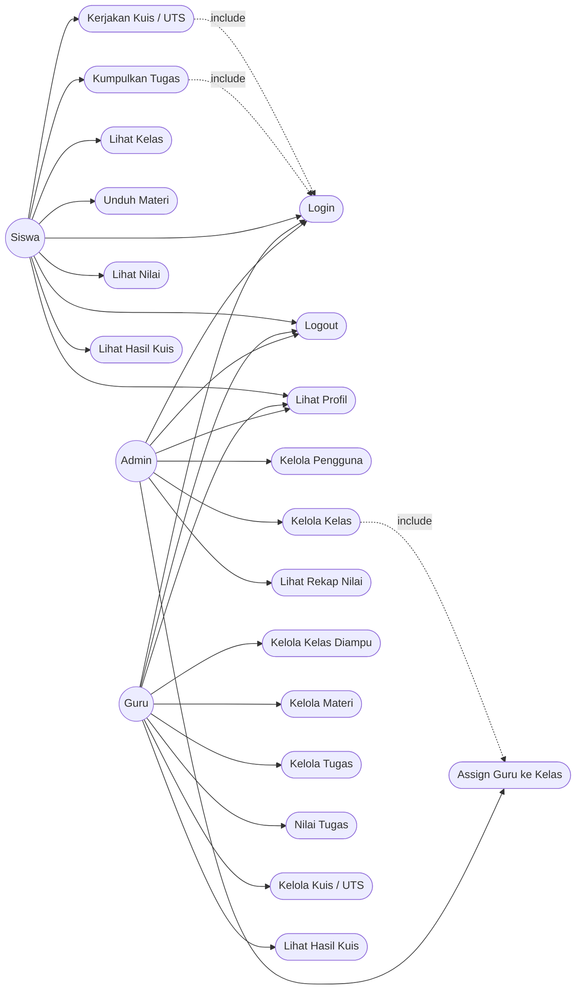
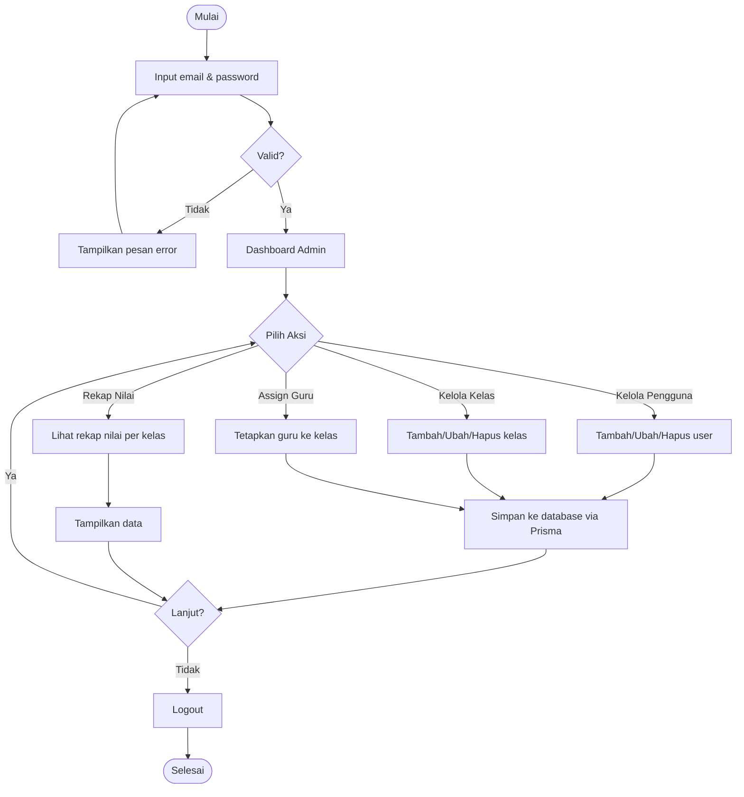
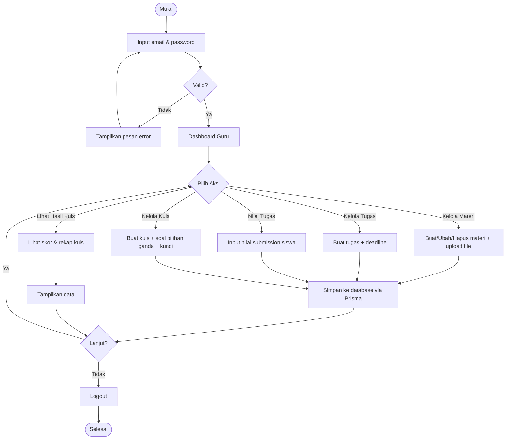
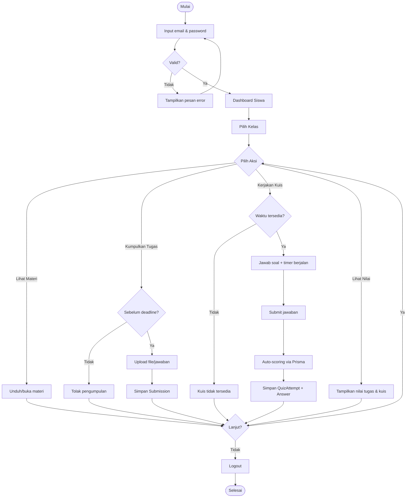
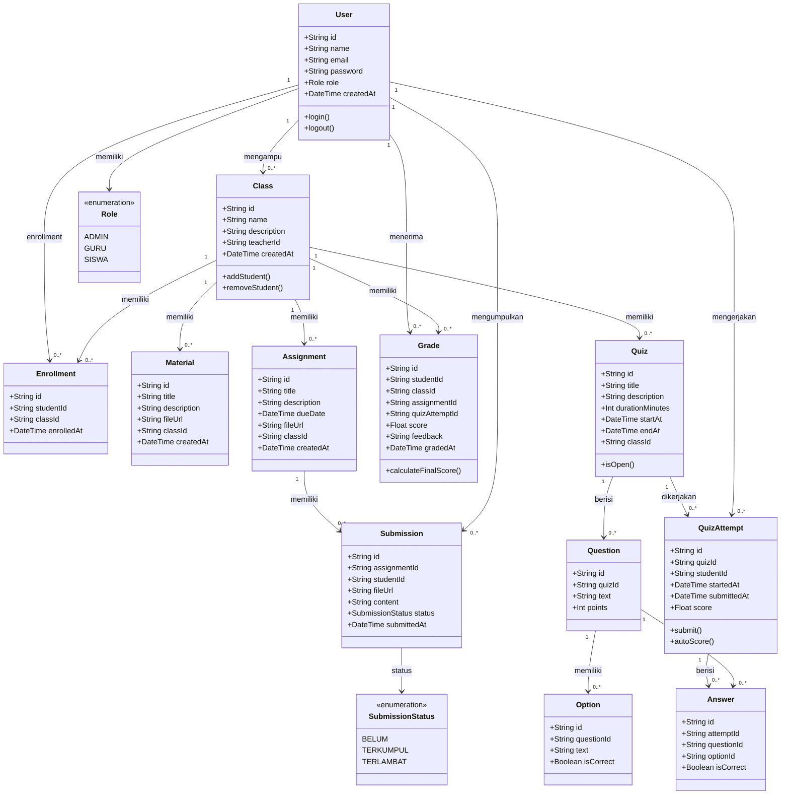

# Diagram UML — LMS NUURUSSAADAH

> Berdasarkan `docs/spesifikasi-final-lms.md`. Diagram ditulis dengan **Mermaid** agar dapat dirender di VS Code / GitHub / Markdown viewer yang mendukung.

Daftar diagram:
1. Use Case Diagram
2. Activity Diagram — Admin
3. Activity Diagram — Guru
4. Activity Diagram — Siswa
5. Class Diagram

---

## 1. Use Case Diagram

> Catatan: Mermaid tidak menyediakan tipe *use case diagram* native, sehingga direpresentasikan dengan flowchart (aktor = node lingkaran, use case = node stadium).

---

## 2. Activity Diagram — Admin

---

## 3. Activity Diagram — Guru

---

## 4. Activity Diagram — Siswa

---

## 5. Class Diagram

---

## Catatan Pemetaan ke Prisma

| Kelas UML | Model Prisma | Keterangan |
|---|---|---|
| User | `User` | Ditambah enum `Role` |
| Class | `Class` | Relasi ke guru (User) |
| Enrollment | `Enrollment` | Tabel pivot siswa ↔ kelas |
| Material | `Material` | Materi per kelas |
| Assignment | `Assignment` | Tugas per kelas |
| Submission | `Submission` | Pengumpulan tugas |
| Grade | `Grade` | Nilai tugas/kuis |
| Quiz | `Quiz` | Kuis/UTS |
| Question | `Question` | Soal pilihan ganda |
| Option | `Option` | Pilihan + kunci |
| QuizAttempt | `QuizAttempt` | Percobaan + skor |
| Answer | `Answer` | Jawaban siswa |
| — | enum `SubmissionStatus` | Status pengumpulan |
