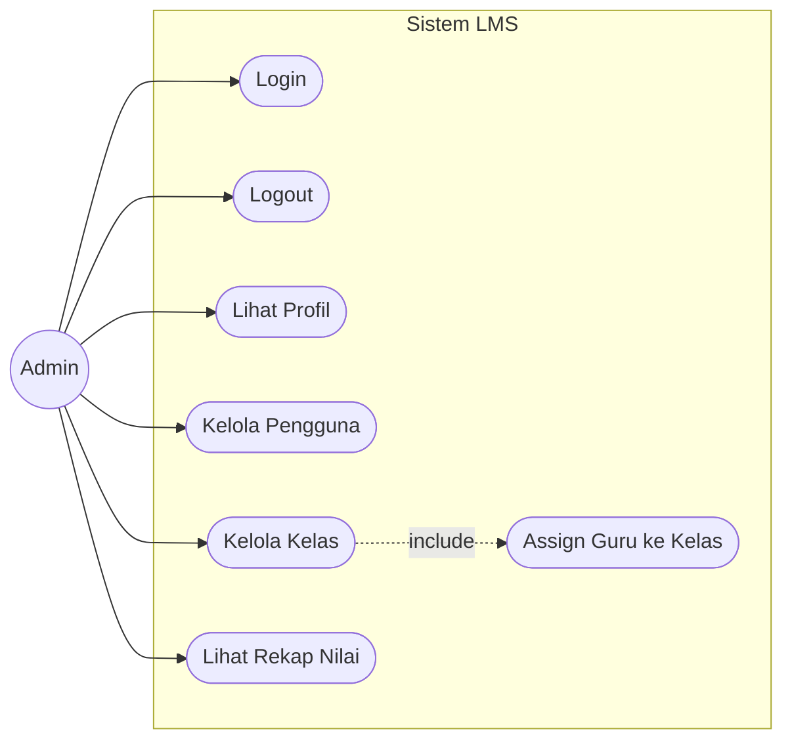
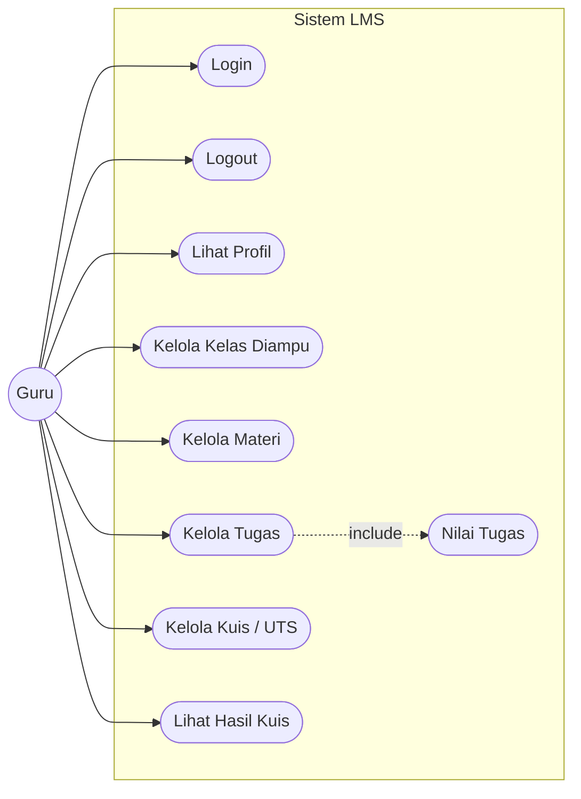
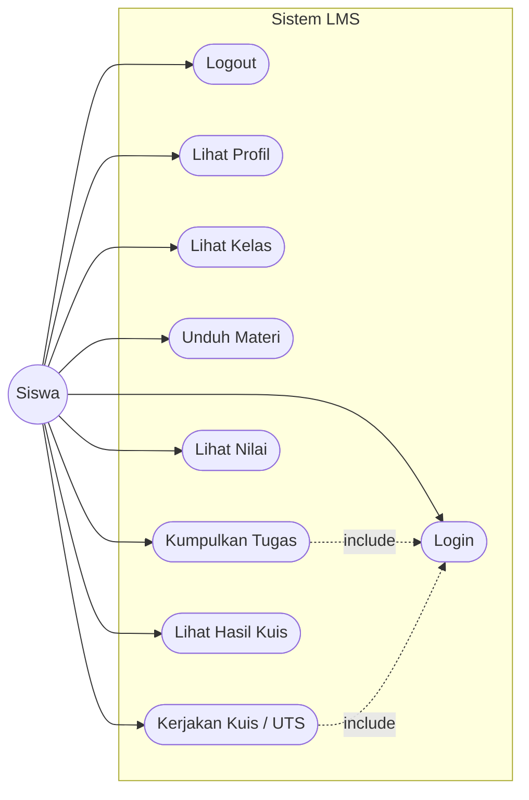

# Use Case Diagram per Aktor — LMS NUURUSSAADAH

> Versi use case yang dipisah per aktor, masing-masing dengan batas sistem (*system boundary*).
> Ditulis dengan Mermaid (flowchart) karena Mermaid tidak menyediakan tipe use case native.

Daftar:
1. Use Case — Admin
2. Use Case — Guru
3. Use Case — Siswa

---

## 1. Use Case Diagram — Admin

---

## 2. Use Case Diagram — Guru

---

## 3. Use Case Diagram — Siswa

